# Cybforge Retro BIOS, UEFI/BIOS Shell & Snake v2.6 (256 KB ROM + CybFS v1.0 Edition)

[](LICENSE)
[](#)
[](#)
[](#)
[](#)
[](#)
[](#)
[](#)

A custom, bare-metal **x86 16/32-bit PC BIOS** in a full **256 KB (`262,144 Bytes`) ROM image**. It boots an authentic AMIBIOS-style POST diagnostic sequence with Sound Blaster 16 hardware auto-detection, features a **Multi-Tab Cybforge Retro BIOS Setup Utility** (`[ 1: Main & Game ]` and `[ 2: BiosShell ]`) with CMOS NVRAM persistence, includes an interactive **UEFI/EFI-style BIOS Shell (`v2.6`)** backed by a real live read/write filesystem (**CybFS v1.0**) and a real hardware PCI Bus Configuration scanner (`0xCF8`/`0xCFC`), and directly launches an arcade **Snake Game v2.6** with **16-bit Sound Blaster 16 PCM WAV audio** in pure assembly.

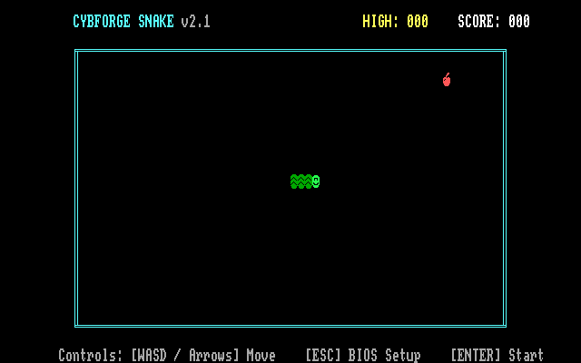

---

## Visual Showcase Gallery

| POST RAM Counter & SB16 Detection | BIOS Setup Tab 1: `[ 1: Main & Game ]` |
| :---: | :---: |
| 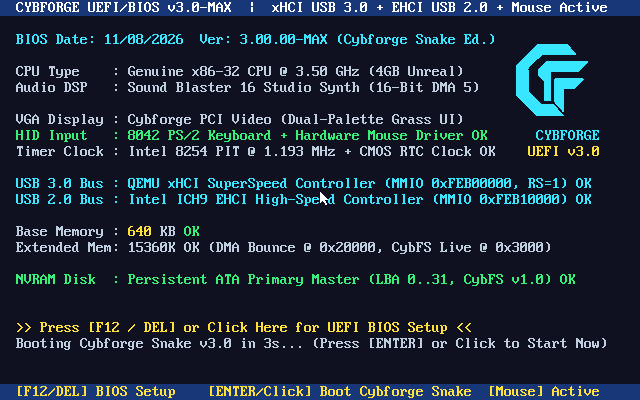 | 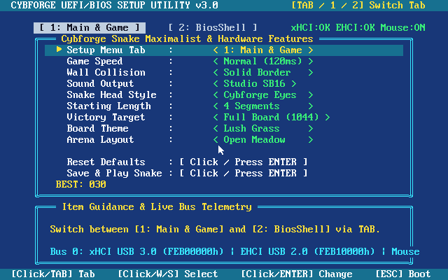 |

| BIOS Setup Tab 2: `[ 2: BiosShell ]` | CybFS v1.0 Live Filesystem (`write`, `append`, `cat`, `ls`) |
| :---: | :---: |
| 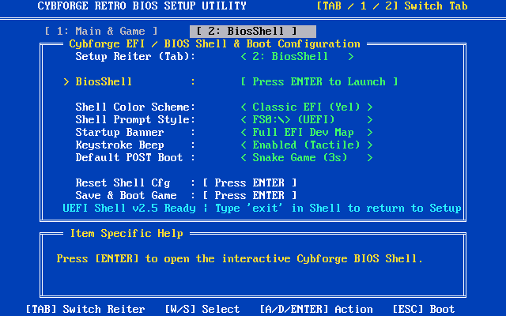 | 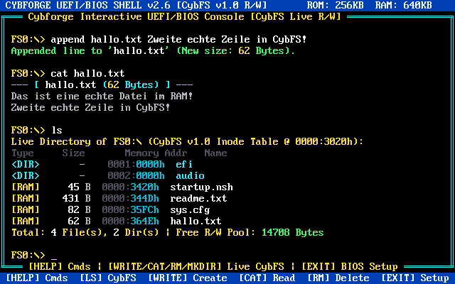 |

| CybFS Script Execution (`run`) & Live Hardware `pci` Scan | ROM-Mapped WAV Directory (`FS0:\AUDIO`) & Live 32-Bit Dump |
| :---: | :---: |
| 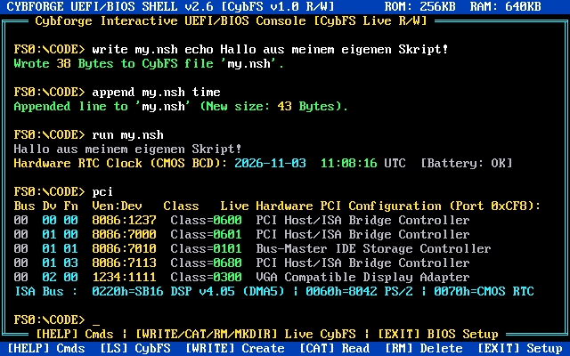 | 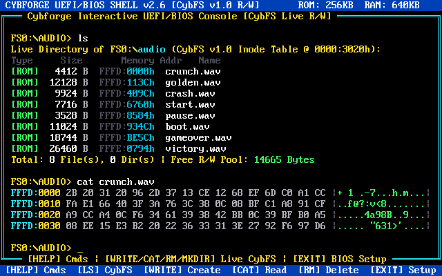 |

| In-Game Pause Modal Dialog `[P]` | Amber CRT Theme & The Maze Arena |
| :---: | :---: |
| 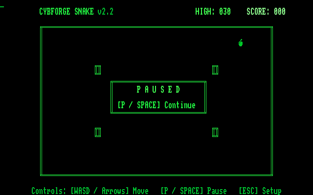 | 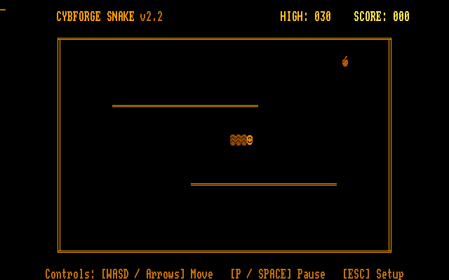 |

| New High Score Initials Entry `[A A A]` | Hall of Champions Top 3 Leaderboard |
| :---: | :---: |
| 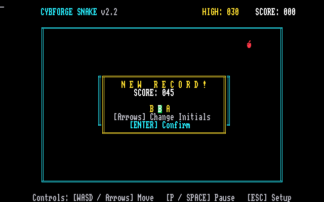 | 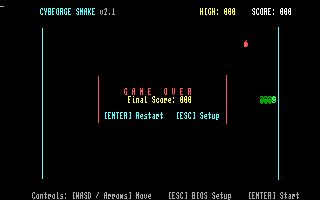 |

| Victory Trophy Screen (Complete Board Takeover) |
| :---: |
| 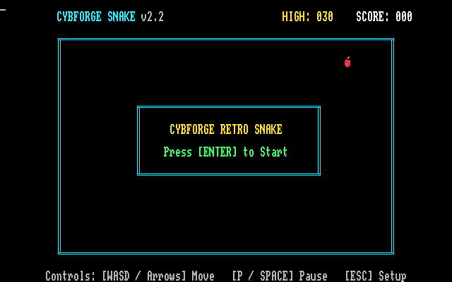 |

---

## Multi-Tab BIOS Setup & Interactive UEFI/BIOS Shell (New in v2.5)

### 1. Multi-Tab BIOS Setup Utility (`[ 1: Main & Game ]` & `[ 2: BiosShell ]`)
Press **`[F12]`** or **`[DEL]`** during POST (or **`[ESC]`** from the game) to open the **Cybforge Retro BIOS Setup Utility**. Switch between the two tabs at any time using **`[TAB]`**, **`[1]` / `[2]`**, or **`[Left]` / `[Right]`** (`[A]` / `[D]`) on the first row (`Setup Reiter (Tab)`):

* **Tab 1 (`[ 1: Main & Game ]`):** Configures `Game Speed`, `Wall Mode`, `Sound Output` (`SB16 16-Bit`, `PC Speaker`, `Dual Audio`, `Muted`), `Snake Face`, `Initial Length`, `Win Target`, `Color Theme`, `Game Arena`, and `Reset High Score`.
* **Tab 2 (`[ 2: BiosShell ]`):**
  * **`BiosShell : [ Press ENTER to Launch ]`** — Immediately launches the interactive **Cybforge UEFI/BIOS Shell v2.40**.
  * **`Shell Color Scheme`** — Select between `< Classic EFI (Yel) >`, `< Matrix Hacker >`, `< Cyber Neon (Cyan) >`, and `< Retro BIOS Blue >`.
  * **`Shell Prompt Style`** — Choose `< FS0:\> (UEFI) >`, `< SHELL> (Compact) >`, or `< root@cybforge:# >`.
  * **`Startup Banner`** — Choose `< Full EFI Dev Map >`, `< Compact Header >`, or `< Quiet (No Banner) >`.
  * **`Keystroke Beep`** — Toggle `< Enabled (Tactile) >` or `< Muted (Silent) >` mechanical keystroke clicks in the shell.
  * **`Default POST Boot`** — Configure whether the 3-second POST countdown boots `< Snake Game (3s) >` or directly into `< BiosShell (3s) >`.
  * **`Reset Shell Cfg`** — Restores all BiosShell settings to factory defaults and saves to CMOS NVRAM.

### 2. Cybforge Interactive UEFI/BIOS Shell (`v2.6`) & CybFS v1.0 Filesystem
Backed by **CybFS v1.0**, a real bare-metal filesystem mounted from ROM Block 0 (`0xFFFC0100`) into a 16 KB live read/write RAM volume (`0x3000..0x6FFF`), with a 32-entry binary Inode table (`0x3020..0x341F`). You can create, overwrite, append to, read, execute, and delete real files and subdirectories in live memory, or inspect/play ROM-mapped files (`0xFFFD0000`–`0xFFFF0000`).

| Command / Alias | Description |
| :--- | :--- |
| **`help`** / **`?`** | Displays the formatted 2-column command reference table |
| **`exit`** / **`quit`** / **`setup`** | Exits the BIOS Shell and returns directly to the **BIOS Setup Utility** |
| **`ls`** / **`dir`** | Dynamically scans the 32-entry CybFS Inode table (`0x3020`), displaying real type (`<DIR>`, `[RAM]`, `[ROM]`, `[HW ]`), real byte size, memory address, name, and free byte pool |
| **`cd <dir>`** / **`cd ..`** / **`cd \`** | Traverses real directory Inodes (`flags == 2`, `parent_id`) and updates the prompt (`FS0:\<DIR>>`) directly from the Inode name |
| **`mkdir <dir>`** / **`md <dir>`** | Allocates a new real directory Inode (`flags = 2`) inside the current directory |
| **`touch <file>`** | Allocates a new real 0-byte file Inode (`flags = 1`) in the current directory |
| **`write <file> <text>`** | Creates or overwrites a real file in the CybFS RAM pool (`0x3420..0x6FFF`), storing exact bytes and updating `file_size` & `FS_ALLOC_PTR` |
| **`append <file> <text>`** | Appends a new text line (`\n`) to an existing RAM file in CybFS and updates its byte size |
| **`cat <file>`** / **`type <file>`** | Reads real file bytes from RAM (`[RAM]`), dumps live 32-bit ROM bytes + plays WAV audio via SB16 DMA (`[ROM]`), or dumps live CMOS (`[HW ]`) |
| **`rm <name>`** / **`del <name>`** | Deletes a file or directory from CybFS by clearing its Inode (`flags = 0`) |
| **`run <file.nsh>`** / **`sh <file.nsh>`** | Reads a script file's real bytes line-by-line from CybFS and executes each command in the BIOS Shell |
| **`format`** | Re-initializes the live CybFS RAM volume (`0x3000..0x6FFF`) from the master image in ROM Block 0 (`0xFFFC0100`) |
| **`pci`** / **`devices`** / **`lspci`** | Live hardware PCI Configuration Mechanism #1 scanner via I/O ports `0xCF8`/`0xCFC` (reads real `Vendor:Device` and `Class/Subclass` registers) |
| **`memtest`** | Performs a real word-by-word write & read-back verification (`cmp word [es:di], 0x55AA` / `0xAA55`) across 64 KB extended RAM (`0x20000..0x2FFFF`) with live error counter |
| **`ver`** / **`version`** | Shows Cybforge UEFI/BIOS Shell version, ROM bank layout, CPU mode, and SB16 DSP info |
| **`map`** | Displays the UEFI-style device mapping table (`FS0:`, `BLK0:`, `BLK1:`, `CMOS0:`, `VGA0:`, `SB16:`) |
| **`memmap`** / **`mem`** | Displays the physical E820/UEFI memory map (`0x00000000`–`0xFFFFFFFF`, 256 KB ROM + 640 KB RAM) |
| **`sysinfo`** / **`neofetch`** | Renders the Cybforge ASCII hardware emblem alongside live system & NVRAM telemetry |
| **`cpu`** / **`regs`** | Dumps live 16-bit x86 segment & pointer registers (`CS`, `DS`, `ES`, `FS`, `SP`) and Unreal Mode status |
| **`cmos`** / **`nvram`** | Reads and hex-dumps live hardware CMOS NVRAM registers `0x40..0x5F` via ports `0x70`/`0x71` |
| **`dmem [hex]`** / **`dump`** | Live 64-byte Hex + ASCII memory viewer (e.g. `dmem 3020` for CybFS Inodes, `dmem fff0` for Reset Vector) |
| **`time`** / **`date`** / **`rtc`** | Reads the live hardware Motorola MC146818 RTC BCD clock & calendar (`20YY-MM-DD HH:MM:SS UTC`) |
| **`sound [0-7]`** / **`play`** | Interactive Sound Blaster 16 16-bit PCM testbench — plays any of the 8 ROM WAV samples via DMA Ch 5 |
| **`io`** / **`ports`** | Reads live hardware I/O port states (`0x60` KBD, `0x61` SPK, `0x64` STS, `0x22C` DSP, `0x3DA` VGA) |
| **`color [0-3]`** | Dynamically switches the Shell color scheme (`0..3`) and persists the choice to CMOS NVRAM |
| **`echo <text>`** | Prints custom text to the terminal |
| **`beep`** | Triggers an acoustic diagnostic tone via the active sound engine |
| **`cls`** / **`clear`** | Clears the terminal viewport and redraws the status bars |
| **`snake`** / **`boot`** | Launches `FS0:\EFI\SNAKE.EFI` directly from the shell |
| **`reboot`** / **`reset`** | Performs a warm reset back to the animated BIOS POST screen |

---

## 256 KB ROM Architecture (4 x 64 KB Blocks)

The BIOS image is constructed as an authentic **256 KB ROM (`262,144 Bytes`)**, organized into four distinct 64 KB physical memory blocks:

```
+-------------------------------------------------------------------------------+
|                           256 KB BIOS ROM ARCHITECTURE                         |
+-------------+-----------------------+-------------------------+---------------+
| ROM Block   | ROM File Offsets      | 32-bit Linear Address   | 16-bit Real   |
|             |                       | (Unreal Mode FS:ESI)    | Mode Segment  |
+-------------+-----------------------+-------------------------+---------------+
| Block 0     | 0x00000 - 0x0FFFF     | 0xFFFC0000 - 0xFFFCFFFF | High ROM      |
|             | (65,536 Bytes)        | ROM Banner & Reserved   | Space         |
+-------------+-----------------------+-------------------------+---------------+
| Block 1     | 0x10000 - 0x1FFFF     | 0xFFFD0000 - 0xFFFDFFFF | High ROM      |
|             | (65,536 Bytes)        | 16-Bit PCM Audio Bank A | Space         |
+-------------+-----------------------+-------------------------+---------------+
| Block 2     | 0x20000 - 0x2FFFF     | 0xFFFE0000 - 0xFFFEFFFF | Segment 0xE000|
|             | (65,536 Bytes)        | 16-Bit PCM Audio Bank B | (0xE000:0000) |
+-------------+-----------------------+-------------------------+---------------+
| Block 3     | 0x30000 - 0x3FFFF     | 0xFFFF0000 - 0xFFFFFFFF | Segment 0xF000|
|             | (65,536 Bytes)        | BIOS Code, Setup, Shell,| (0xF000:0000) |
|             |                       | Snake & Reset Vector    | (Reset: FFF0h)|
+-------------+-----------------------+-------------------------+---------------+
```

---

## Sound Blaster 16 Digital Audio Engine (16-Bit PCM)

### 1. Hardware Architecture & Unreal Mode
* **Flat Real Mode (Unreal Mode):** Uses a brief switch into Protected Mode during boot to load a 4 GB data segment descriptor into `FS`, then immediately returns to 16-bit Real Mode. This allows Real Mode instructions (`a32 mov eax, [fs:esi]`) to access any byte across the entire 256 KB ROM.
* **Intel 8237A DMA Channel 5:** Configured for high-speed 16-bit word streaming from conventional RAM at physical address `0x20000` (DMA Page register `0x8B = 0x02`, Base `0xC4 = 0x0000`, Mode `0xD6 = 0x49`).
* **SB16 DSP 4.xx Control:** Initialized via DSP reset (`Port 0x226`), speaker enabled (`DSP 0xD1`), sample rate configured (`DSP 0x41` for 11,025 Hz), and triggered using 16-bit single-cycle DMA transfers (`DSP 0xB0`, Mode `0x10` Signed Mono).
* **Hardware Mixer (`Ports 0x224 / 0x225`):** Dynamically programs Master Volume (L/R `0x30`, `0x31`) and Voice Volume (L/R `0x32`, `0x33`) to `0xF8` for crisp, high-amplitude acoustic output.

### 2. High-Definition 16-Bit Sound Bank (11,025 Hz)
| Index | ID | Description | Samples | Duration | Linear ROM Address |
| :---: | :--- | :--- | :---: | :---: | :---: |
| **0** | `SND_CRUNCH` | Crisp apple bite (exponential FM + noise crunch) | 2,206 | 0.20s | `0xFFFD0000` |
| **1** | `SND_GOLDEN` | Magical ascending polyphonic chime (E6-G#6-B6-E7) | 6,064 | 0.55s | `0xFFFD113C` |
| **2** | `SND_CRASH` | Sub-bass impact + metal shatter noise transient | 4,962 | 0.45s | `0xFFFD409C` |
| **3** | `SND_START` | Arcade power coin / start chime (E5-A5-C#6) | 3,858 | 0.35s | `0xFFFD6760` |
| **4** | `SND_PAUSE` | Futuristic double-tone pause chirp | 1,764 | 0.16s | `0xFFFD8588` |
| **5** | `SND_BOOT` | Cyber startup chord (C5 + G5 + C6 + E6) | 5,512 | 0.50s | `0xFFFD9350` |
| **6** | `SND_GAMEOVER` | Melancholic minor descent (A4-F4-D4-C#4) | 9,372 | 0.85s | `0xFFFDBE64` |
| **7** | `SND_VICTORY` | Majestic polyphonic brass fanfare | 13,230 | 1.20s | `0xFFFE079C` |

---

## Controls

| Screen | Action | Key(s) |
| :--- | :--- | :--- |
| **POST Screen** | Enter BIOS Setup | `[F12]` or `[DEL]` |
| **POST Screen** | Boot Default Target Immediately | `[ENTER]` |
| **BIOS Setup** | Switch Setup Tab (`Main & Game` / `BiosShell`) | `[TAB]`, `[1]` / `[2]`, or `[Left]` / `[Right]` on Row 1 |
| **BIOS Setup** | Navigate Items | `[W]` / `[S]` or `[Up]` / `[Down]` |
| **BIOS Setup** | Change Setting / Launch BiosShell | `[A]` / `[D]`, `[Left]` / `[Right]`, or `[ENTER]` / `[SPACE]` |
| **BIOS Setup** | Save & Boot Game | `[ESC]` or select `Save & Boot Game` |
| **BIOS Shell** | Execute Command / Recall History / Auto-Complete | `[ENTER]` to run, `[Up]` for history, `[TAB]` to complete |
| **BIOS Shell** | Return to BIOS Setup | Type **`exit`**, **`quit`**, or **`setup`** + `[ENTER]` |
| **Snake Game** | Steer Snake | `[W]` `[A]` `[S]` `[D]` or `[Arrow Keys]` |
| **Snake Game** | Pause / Resume | `[P]` or `[SPACE]` |
| **Snake Game** | Exit to BIOS Setup | `[ESC]` |

---

## Building and Running

### Prerequisites
* [NASM](https://www.nasm.us/) (Netwide Assembler)
* [QEMU](https://www.qemu.org/) (`qemu-system-x86_64`)
* Python 3 (for `gen_bios.py`)

### 1. Launch with One Click
Double-click:
```cmd
run.bat
```
`run.bat` automatically checks screen resolution, builds `bios.bin` (256 KB) if missing, and launches QEMU with Sound Blaster 16 DMA audio, DirectSound low latency, and hardware OpenGL scaling:
```cmd
qemu-system-x86_64 -bios bios.bin -audiodev dsound,id=snd0,latency=20000 -machine pc,pcspk-audiodev=snd0 -device sb16,audiodev=snd0 -display gtk,gl=on,zoom-to-fit=on
```

### 2. Manual Build
To re-generate `bios.asm`, synthesize the 16-bit PCM sound bank, and assemble `bios.bin` (256 KB):
```cmd
build.bat
```

---

## Changelog

### v2.6: CybFS v1.0 Live Read/Write Filesystem & Hardware PCI Scanner
- **CybFS v1.0 Bare-Metal Filesystem**:
  - Replaced hardcoded shell file listings with a **real Inode-based filesystem (`CybFS v1.0`)** stored as a binary master image in ROM Block 0 (`0xFFFC0100`) and mounted into a 16 KB live read/write RAM volume (`0x3000..0x6FFF`).
  - Added full read/write file and directory management commands: `ls`/`dir` (dynamic 32-inode scan with live byte counter), `cd` (real Inode directory traversal), `mkdir`/`md`, `touch`, `write <file> <text>`, `append <file> <text>`, `rm`/`del`, `cat`/`type` (reads real RAM files, plays & hex-dumps 32-bit ROM WAV files, or dumps CMOS), `run`/`sh <file.nsh>` (line-by-line script execution), and `format`.
- **Live Hardware PCI Bus Scanner & RAM Verification**:
  - Replaced static PCI device strings with a live **PCI Configuration Mechanism #1 scanner** (`Ports 0xCF8 / 0xCFC`) that queries real hardware `VendorID:DeviceID` and `Class/Subclass` registers across Bus 0.
  - Upgraded `memtest` to perform a word-by-word read-back verification (`cmp word [es:di], 0x55AA` / `0xAA55`) across 64 KB extended RAM (`0x20000..0x2FFFF`) with a live error counter.
  - Upgraded the VGA display engine to a genuine **16-scanline IBM VGA 8x16 font** (`CRTC 0x09 = 0x0F`, hardware cursor hidden via `CRTC 0x0A = 0x20`) with a framed double-line BIOS Shell console UI.

### v2.5: Multi-Tab BIOS Setup & Interactive UEFI/BIOS Shell
- **Multi-Tab BIOS Setup Utility**:
  - Added visual Tab Bar (`[ 1: Main & Game ]` and `[ 2: BiosShell ]`) switchable via `[TAB]`, `[1]`/`[2]`, or `[Left]`/`[Right]` on the `Setup Reiter (Tab)` option.
  - Added `BiosShell : [ Press ENTER to Launch ]` entry and 5 CMOS-persisted shell configuration options (`Shell Color Scheme`, `Shell Prompt Style`, `Startup Banner`, `Keystroke Beep`, `Default POST Boot`, plus `Reset Shell Cfg`).
  - Extended CMOS NVRAM persistence (`0x40..0x5E`, signature `0xCC`) to store all BiosShell settings across reboots.
- **Interactive UEFI/BIOS Shell (`v2.40`)**:
  - Implemented full keyboard driver with Shift support, `[UP ARROW]` history recall, `[TAB]` auto-completion, and hardware VRAM scrolling.
  - Added 23 built-in commands (`help`, `ver`, `map`, `memmap`, `ls`/`dir`, `cd`, `cat`, `sysinfo`/`neofetch`, `pci`/`devtree`, `cpu`/`regs`, `cmos`/`nvram`, `dmem`, `time`/`rtc`, `sound [0-7]`, `io`, `memtest`, `color`, `echo`, `beep`, `cls`, `snake`, `reboot`, and `exit`/`quit`/`setup` to return directly to BIOS Setup).

### v2.4: Ultra-Responsive Start & SB16 Single-Cycle DMA Fixes
- Replaced SB16 DSP command `0xB6` with `0xB0` (Single-Cycle DMA) + interrupt acknowledgment (`0x22F`/`0x22E`) and `0xD5` pause to eliminate DSP write buffer lockups.
- Reduced start screen polling delay to ~1ms (`200k` cycles) and allowed instant start via `[ENTER]`, `[SPACE]`, or directional keys (`[W]`/`[S]`/`[D]`/Arrows).

## License

This project is licensed under the [MIT License](LICENSE) - see the LICENSE file for details.

Copyright (c) 2026 Cybforge.
